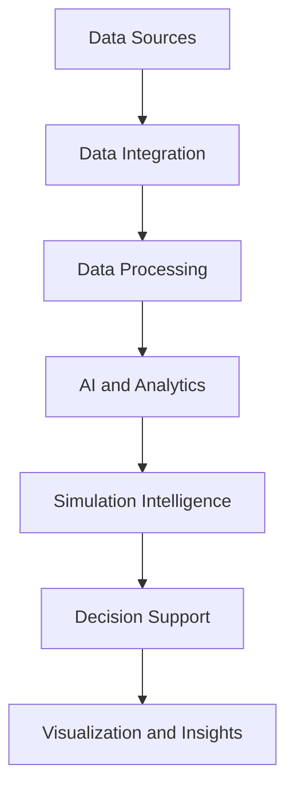

 

  

# EIPPONE SIMULATION DYNAMICS

*Simulate the future. Neutralize uncertainty. Make confident decisions.*

**AI-driven Simulation Intelligence for Finance, Cybersecurity, Environmental and Enterprise Systems**

  
  
  
  
  

  
  
  
  

[Website](https://www.eippone.com) •
[GitHub Organization](https://github.com/orgs/eippone/repositories) •
[Contact](https://www.eippone.com)

---

## Welcome

**EIPPONE Simulation Dynamics Inc.** is a Canadian research-driven engineering company developing AI-powered Simulation Intelligence platforms.

We focus on helping organizations understand complex systems, explore possible scenarios, evaluate uncertainty and make more informed decisions.

Our work brings together:

- Simulation Intelligence
- Synthetic Data Generation
- Rare-Event Analysis
- Artificial Intelligence and Machine Learning
- Digital Twin concepts
- Decision Intelligence and Analytics

Our goal is to help organizations move beyond observing what has happened toward exploring what could happen next.

## Overview

The EIPPONE ecosystem brings together research, software engineering and applied AI across several domains.

Our areas of focus include:

- Financial intelligence and risk analysis
- Cybersecurity intelligence and threat simulation
- Environmental and climate analytics
- Enterprise intelligence and operational simulation
- Research, experimentation and data-driven innovation

We take a modular approach to developing intelligence capabilities that can support different business and research environments.

## Vision

To advance a future in which organizations can explore complex possibilities, anticipate emerging risks and make confident decisions using simulation, AI and data-driven intelligence.

**Simulate the future. Neutralize uncertainty. Make confident decisions.**

## Our Mission

To build trusted AI-augmented Simulation Intelligence platforms that help organizations simulate, analyze and understand complex financial, operational, cyber and environmental systems.

## Engineering Philosophy

Our work is guided by four principles:

1. **Better information supports better decisions.** Data quality and context matter.
2. **AI should be explainable and accountable.** Intelligence must support responsible decision-making.
3. **Rare events matter.** Low-frequency, high-impact events deserve careful attention.
4. **Simulation connects data to strategy.** Exploring possible outcomes helps decision-makers prepare for uncertainty.

---

## Core Intelligence Domains

### Financial Intelligence

Exploring financial behaviour, market dynamics and risk through data analytics and simulation.

Areas of focus:

- Financial market analysis
- Portfolio and investment analytics
- Risk assessment and stress testing
- Market and volatility forecasting
- Financial scenario simulation

### Cyber Intelligence

Supporting a more proactive understanding of cyber threats, security events and potential attack scenarios.

Areas of focus:

- Threat and anomaly analysis
- Security event intelligence
- Behavioural analytics
- Cyber threat simulation
- Attack scenario modelling
- Security operations intelligence

### Environmental Intelligence

Applying data and analytical methods to environmental systems and sustainability challenges.

Areas of focus:

- Climate and environmental analytics
- Air quality and pollution analysis
- Geospatial intelligence
- Environmental scenario modelling
- Disaster risk analysis
- Sustainability insights

### Enterprise Intelligence

Exploring how AI and simulation can support enterprise operations, governance and decision-making.

Areas of focus:

- Operational intelligence
- Digital Twin concepts
- Enterprise analytics
- Governance and compliance insights
- Executive decision support

---

## Simulation Intelligence

Simulation is central to the EIPPONE approach.

Our research and development focus includes the exploration of complex systems and alternative scenarios across financial, cyber, environmental and enterprise environments.

### Core capabilities

- Scenario-based simulation
- Stochastic and uncertainty analysis
- Synthetic data generation
- Rare-event modelling
- Predictive and anomaly analytics
- Multi-agent system concepts
- Risk and stress testing
- Decision-support insights

These capabilities are intended to help users investigate possible outcomes and understand the assumptions and uncertainty behind analytical results.

## Platform Architecture

EIPPONE follows a modular, high-level architecture that connects data, intelligence and decision support.

The architecture represents the broad functional direction of the ecosystem, rather than a specification of proprietary implementation details.

### Our design direction

- Modular intelligence capabilities
- Flexible data integration
- Scalable analytical workflows
- Interoperability across business domains
- Responsible AI and governance considerations
- Accessible insights for technical and business users

Our product design philosophy also emphasizes flexible delivery: where applicable, solutions are designed with both portable local use and web-based access in mind.

---

## Research and Innovation

Research and experimentation are important parts of EIPPONE's development approach.

Our areas of interest include:

- Applied AI and machine learning
- Synthetic data research
- Rare-event and uncertainty modelling
- Simulation-based experimentation
- Digital Twin applications
- Data quality and governance
- AI-assisted analytics
- Reproducible research and evaluation

We welcome opportunities to collaborate with researchers, institutions, developers and organizations interested in applied AI and Simulation Intelligence.

---

## EIPPONE Platform Portfolio

The EIPPONE portfolio brings together products and initiatives addressing different intelligence and simulation needs.

| Platform | Focus |
|---|---|
| **EIPPONE SDG Pro** | Synthetic Data Generation |
| **EIPPONE RES-X** | Rare-Event Simulation |
| **EIPPONE DT-Ops** | Digital Twin Operations |
| **EIPPONE A2I Insights** | Executive Intelligence and Analytics |
| **EIPPONE A2I Copilot** | Conversational Analytics and Decision Support |
| **EIPPONE CYB-SimX** | Cyber Attack Simulation |
| **EIPPONE FinSim-360** | Financial Market Simulation |
| **EIPPONE DQ-AI** | Data Quality and Governance |
| **Simulation Dynamics API Hub** | Enterprise Integration and API Initiatives |

*Product names and descriptions identify areas of focus within the EIPPONE portfolio. Availability, capabilities and release status may vary by product.*

---

## Technology and Innovation Areas

EIPPONE explores and applies technologies across several complementary areas:

| Area | Focus |
|---|---|
| Artificial Intelligence | Applied AI and machine learning |
| Generative AI | Large Language Models and generative methods |
| Knowledge Intelligence | Retrieval-Augmented Generation and information retrieval |
| Simulation | Stochastic, scenario-based and rare-event analysis |
| Digital Twins | Modelling and understanding complex systems |
| Data Engineering | Data integration, processing and analytics |
| Business Intelligence | Reporting, visualization and decision support |
| Cloud and Application Engineering | Flexible application and platform delivery |
| Data Governance | Data quality, responsible use and oversight |

Our technology choices may evolve as research, product requirements and deployment needs change.

---

## Development Roadmap

EIPPONE's development direction includes the following themes:

- [x] Establish the EIPPONE Simulation Intelligence vision and product portfolio
- [x] Develop foundational simulation and AI initiatives
- [x] Advance financial and cybersecurity intelligence research
- [ ] Expand enterprise Simulation Intelligence capabilities
- [ ] Advance Digital Twin applications
- [ ] Explore emerging simulation and computational methods
- [ ] Expand research collaborations and ecosystem integrations
- [ ] Develop additional AI-assisted decision-support capabilities

The roadmap describes areas of development interest and does not represent a commitment to a particular release date.

---

## Collaboration and Contributions

We welcome conversations and collaboration with people and organizations interested in:

- Applied AI and Simulation Intelligence
- Academic and scientific research
- Synthetic data and rare-event analysis
- Financial and cybersecurity innovation
- Environmental analytics
- Enterprise AI and digital transformation
- Research partnerships and pilot initiatives

### How to contribute

For repositories that accept community contributions:

1. Review the repository's README and contribution guidance.
2. Fork the repository.
3. Create a focused feature branch.
4. Document your proposed changes.
5. Submit a pull request for review.

Please check each repository for its contribution rules, licensing terms and project status before submitting work.

### 📖 Contributor Guide · 💙 Research Collaboration · Support EIPPONE

### Connect with EIPPONE

For corporate enquiries, business partnerships and general information about EIPPONE Simulation Dynamics Inc., visit:

**[www.eippone.com](https://www.eippone.com)**

---

## Security and Responsible Disclosure

Security and responsible technology development are important considerations across the EIPPONE ecosystem.

If you identify a potential security vulnerability in an EIPPONE repository:

- Do not publicly disclose exploitable details before the issue has been addressed.
- Avoid accessing, modifying or exposing data that does not belong to you.
- Use GitHub's private vulnerability reporting feature where it is enabled for the repository, or contact EIPPONE through its official website.

Please review the security guidance and policies of the individual repository as well.

---

## Intellectual Property and Licensing

© 2026 **EIPPONE Simulation Dynamics Inc.** All rights reserved.

EIPPONE product names, brand assets, proprietary software, platform concepts, original research, methodologies and commercial technologies may be protected by intellectual property rights.

**Open-source licensing is determined at the individual repository level.** Please consult the applicable `LICENSE` file before using, modifying, distributing or incorporating any repository content into another project.

Unless a licence or written permission expressly grants those rights, no permission to use EIPPONE proprietary technology, trademarks or commercial materials is implied by their appearance in this organization.

---

## Connect with EIPPONE

We are interested in connecting with organizations, researchers, developers and partners who share an interest in the future of AI, simulation and decision intelligence.

### SIMULATE THE FUTURE.
### NEUTRALIZE UNCERTAINTY.
### MAKE CONFIDENT DECISIONS.

**EIPPONE Simulation Dynamics Inc.**

🌐 [www.eippone.com](https://www.eippone.com)

[Explore EIPPONE on GitHub](https://github.com/orgs/eippone/repositories)

© 2026 EIPPONE Simulation Dynamics Inc.

*Built by EIPPONE · Simulation Intelligence and Applied AI*

